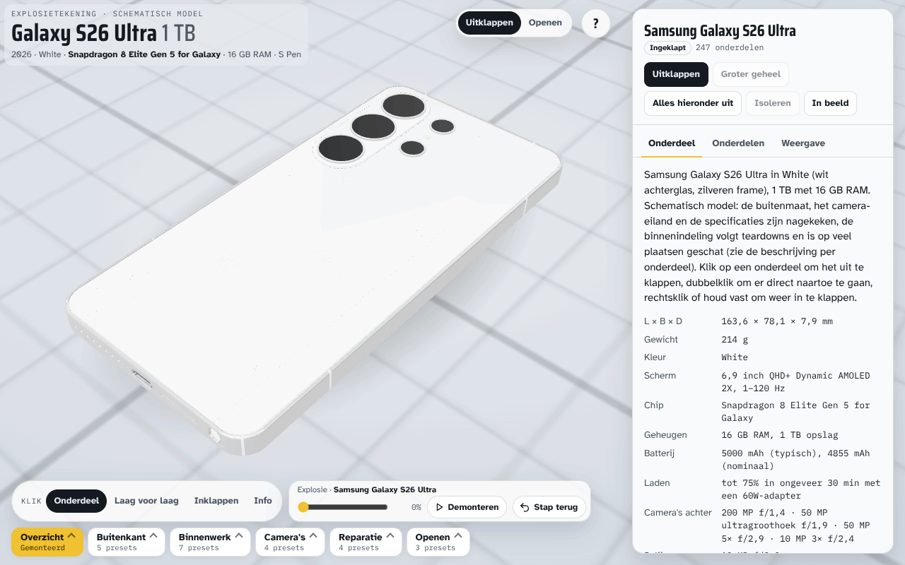
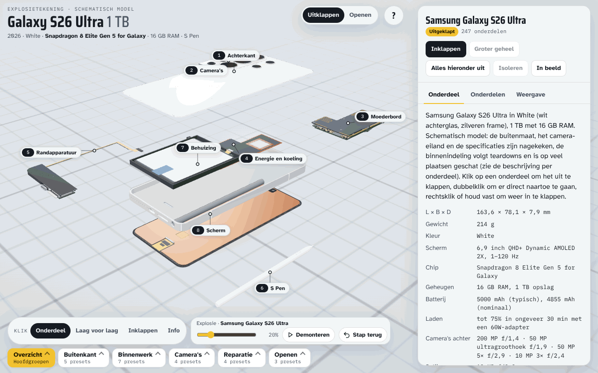
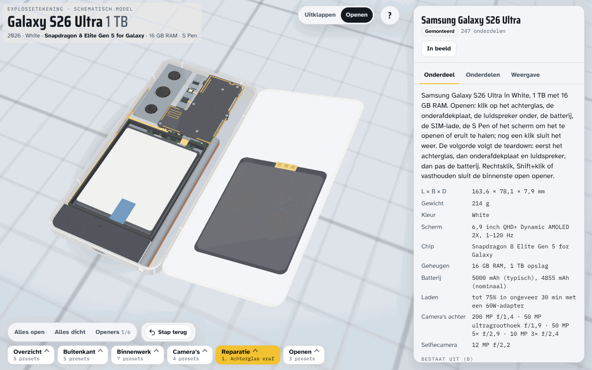

# Galaxy S26 Ultra explosietekening

Interactieve 3D-explosietekening van een Samsung Galaxy S26 Ultra (1 TB, 16 GB RAM, White) in de browser. Klik op een
onderdeel om zijn groep uit te klappen, dubbelklik om er direct heen te gaan, rechtsklik of houd vast om in te klappen. Alle
geometrie staat in JavaScript; er worden geen 3D-bestanden, foto's of productteksten gebruikt.

Onafhankelijk schematisch model, niet van of namens Samsung. Samsung en Galaxy zijn merken van Samsung Electronics.

## Stand

Alle golven van `docs/masterplan.md` zijn uitgevoerd. Het toestel bestaat uit acht hoofdgroepen:
- achterkant;
- camera's;
- moederbord;
- energie en koeling;
- randapparatuur;
- S Pen;
- behuizing;
- scherm.

Daarnaast zijn er:
- openers: achterglas, luidspreker en onderafdekplaat, batterij, SIM-lade, S Pen en scherm;
- 28 presets in zes categorieën en een rondleiding met de batterijwissel;
- Samsung-servicenummers met bron per onderdeel.

De kerncijfers staan in `docs/cijfers.md`; wat bevestigd is en wat geschat, staat in `docs/specificaties-en-bronnen.md`.





## Bouwen en testen

```
tools/setup.sh                                  # Playwright, three.js 0.147.0 (met hashcontrole), Chromium
python3 build.py --lint                         # controles zonder te schrijven
python3 build.py                                # schrijft index.html
tools/orkestratie/finaltests.sh UITMAP          # volledige strikte testset, één exitcode
```

`index.html` is één bestand. three.js r147 komt van jsDelivr, met integriteitshashes. Zet je het bestand op een webserver of
GitHub Pages, dan werkt het.

## Documentatie

- `CLAUDE.md`: afspraken voor wie hier bouwt.
- `docs/masterplan.md`: doel, keuzes, ontwerpbesluiten en de golven.
- `docs/ontwerp-en-architectuur.md`: bouw, onderdelenboom, schaal en assen, eigendom, openers.
- `docs/indeling.md`: het ruimtelijk contract tussen de domeinen (lagen, zones, camera-eiland).
- `docs/testen.md`: de testset en wat elke test bewaakt.
- `docs/specificaties-en-bronnen.md`: geverifieerde gegevens en bronnen.
- `docs/onderdeelnummers-schema.md`: de CSV met onderdeelnummers.

## Licentie

MIT, zie `LICENSE`.
